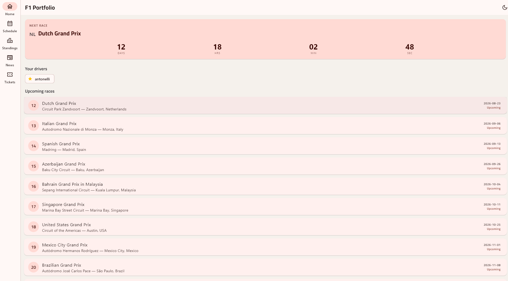
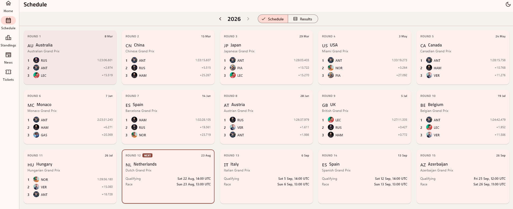
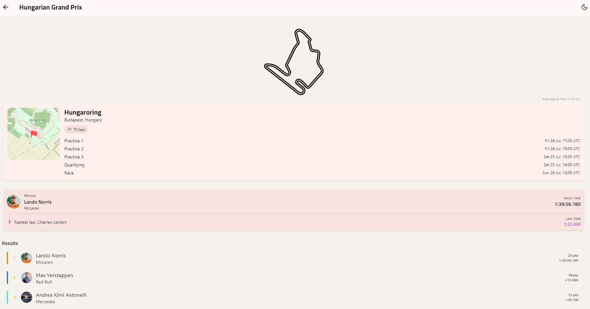

# F1 App

A cross-platform Formula 1 companion app covering race schedules, results,
championship standings, circuit detail, and live news. Built with a **Flutter**
front end and a **FastAPI + PostgreSQL** backend.

Runs from a single codebase on **Android, iOS, Windows and macOS**.

<!-- SCREENSHOTS: add 2-4 images here, e.g.
<p align="center">
  
  
  
</p>
-->

## Features

| | |
|---|---|
| **Home** | Live countdown to the next race, favourited drivers, upcoming rounds |
| **Schedule** | Full season browser: card grid with podium previews and session times, or a results table. Any season back to 1950. |
| **Race detail** | Track outline diagram, interactive circuit map, weekend session times, full classification with fastest lap. Upcoming races show circuit history instead. |
| **Standings** | Driver and constructor tables, plus a season points-progression chart |
| **Driver & team pages** | Photos, career stats, recent results, favourite toggle |
| **News** | Live F1 headlines with images |
| **Themes** | Light and dark, with an F1-inspired palette |

## Tech stack

**Backend:** Python, FastAPI, PostgreSQL, SQLAlchemy ORM, Alembic migrations, Docker

**App:** Flutter/Dart, Provider (state management), `fl_chart`, `flutter_map`

**Data:** [Jolpica F1 API](https://api.jolpi.ca/ergast/f1/) (the open-source Ergast
successor), [Wikipedia REST API](https://en.wikipedia.org/api/rest_v1/) for driver
photos, an RSS feed for news, and [f1db](https://github.com/f1db/f1db) (CC BY 4.0)
for track diagrams. No API keys required, since every source is free and key-free.

## How it works

The Flutter app never calls third-party APIs directly. The FastAPI backend sits in
front of them, normalises the data into its own schema, and caches it in Postgres.

```
Flutter app  ─►  FastAPI  ─►  Postgres cache ─► (miss) ─► Jolpica / Wikipedia / RSS
```

A few decisions worth calling out:

**Caching around a rate limit.** Jolpica is volunteer-run with a 200 req/hour cap
and no uptime guarantee. Every response is cached in a `jolpica_cache` table with a
configurable TTL, and parsed into normalised tables (`races`, `drivers`,
`race_results`, and so on). The app keeps working from cached data when the upstream
is slow or briefly down.

**Bulk endpoints over N+1 requests.** Showing podium previews for a whole season
would mean roughly 24 API calls. `/api/races/{season}/podiums` fetches the season in
a handful of paginated upstream requests instead, then serves it from Postgres.

**Results are gated on race date, not data presence.** The upstream dataset can
carry projected results for races that haven't happened yet, so the app treats a
race as completed only once its start time has passed. Otherwise every future round
would display a fabricated podium.

**Driver photos are resolved once, then cached permanently.** There's no free API
for official F1 headshots, so the backend resolves each driver's Wikipedia photo and
stores the URL. A null column means "not looked up"; an empty string means "looked
up, none exists", so drivers without photos aren't retried forever.

## Running locally

**Requires** Docker, Python 3.11+, and Flutter 3.32+.

```bash
# 1. Environment
cp .env.example .env

# 2. Database
docker compose up -d

# 3. Backend
cd backend
python -m venv .venv && .venv\Scripts\activate   # Windows
pip install -r requirements.txt
alembic upgrade head
uvicorn app.main:app --reload --port 8000

# 4. App (in a second terminal)
cd mobile_app
flutter pub get
flutter run -d windows        # or macos / an Android or iOS device
```

Interactive API docs are at `http://localhost:8000/docs`.

The app resolves the backend URL automatically: `localhost` on desktop and iOS
simulators, `10.0.2.2` on Android emulators. For a physical device or a deployed
backend, override it:

```bash
flutter run --dart-define=API_BASE_URL=http://192.168.1.23:8000
```

## API reference

| Endpoint | Returns |
|---|---|
| `GET /api/races/{season}` | Season schedule |
| `GET /api/races/{season}/{round}` | One race: results, or session times if upcoming |
| `GET /api/races/{season}/podiums` | Top 3 for every race in a season, in one request |
| `GET /api/standings/drivers/{season}` | Driver standings |
| `GET /api/standings/constructors/{season}` | Constructor standings |
| `GET /api/standings/progression/{season}` | Cumulative points per round |
| `GET /api/drivers/{driver_ref}` | Driver bio, career totals, recent results |
| `GET /api/constructors/{constructor_ref}` | Constructor info, career wins, recent results |
| `GET /api/circuits/{circuit_ref}/history` | Last winner and fastest lap at a circuit |
| `GET /api/news` | Latest F1 headlines |

## Deployment

The backend ships with a `Dockerfile` and a `render.yaml` blueprint, and runs on
free tiers: a Docker web service for the API, with Postgres hosted separately.
Migrations run automatically on container start.

Release builds point at a deployed backend at compile time:

```bash
flutter build windows --release --dart-define=API_BASE_URL=https://your-api.onrender.com
```

## Project layout

```
backend/
  app/
    models/      SQLAlchemy ORM models
    schemas/     Pydantic request/response models
    routers/     FastAPI endpoints
    services/    Jolpica, Wikipedia, news clients + sync logic
  alembic/       Database migrations
mobile_app/
  lib/
    models/      Dart models mirroring the API
    services/    API client
    providers/   State management
    screens/     App screens
    widgets/     Shared UI components
  assets/        Track diagrams (light + dark)
```

## Notes

- Jolpica is a free, volunteer-run service, so its data is best-effort. The caching
  layer above exists precisely because of that.
- `backend/app/services/sportradar/` is a deliberate stub, structured so a paid
  timing-data provider could be added without touching existing code.
- Track diagrams are from [f1db](https://github.com/f1db/f1db), licensed
  [CC BY 4.0](https://creativecommons.org/licenses/by/4.0/).
